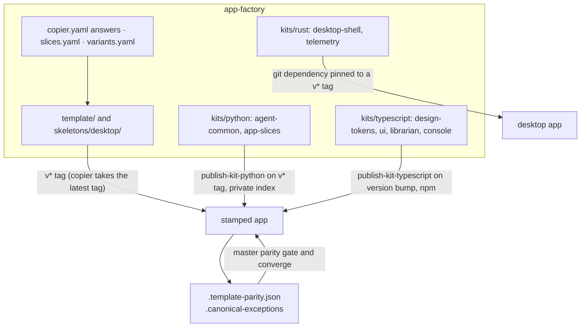

# App Factory: Architecture

## System Overview

## How a fix reaches an app

1. **Edit** `template/` (or a kit) here, with `CHANGELOG.md` in the same change.
2. **Tag.** Whoever merges cuts `vYYYY.M.x`. Copier resolves the latest tag, never `main`; an untagged change reaches nothing and nothing errors.
3. **Take.** The app takes the files (mostly directly, sometimes `copier update`) and regenerates its parity manifest in the same commit.
4. **Gate.** The app's parity check compares each factory-owned file with its manifest.

## Component Responsibilities

### Template (`template/`) and copier

- **Does**: renders the web app from the `copier.yaml` answers; `omitted_slices` removes `agent`, `feedback`, `alerts`, `files` (P09). `slices.yaml` maps each slice to its files.
- **Does NOT**: carry app domain code, or reach an app between tags.

### Parity manifest (`.template-parity.json`, in each app)

- **Does**: records the sha256 of each factory-owned file as the template renders it for that app's answers, plus the template commit. An edited factory file fails the app's CI.
- **Does NOT**: update itself. Each app measures against its own copy, so a stale one reports green against an old factory. `household-precommit-template-parity --generate .` rewrites it.

### Exceptions

- **`.canonical-exceptions`** (in each app) records `parity:<path>` or `deps:<name>`, dated, with a reason. `variants.yaml` here holds the operator-ratified permanent differences; both gates read it.

### Kits

- **`kits/python`** publishes every uv-workspace package to the private index at the release tag's own version.
- **`kits/typescript`** publishes to public npm when `package.json` `version` is new; OIDC trusted publishing, no package tag.
- **`kits/rust`** is a git dependency pinned to a factory `v*` tag.
- **Does NOT**: a kit release is never a package tag; only the factory's `v*` are tags.

### Desktop skeleton (`skeletons/desktop/`)

- **Does**: one source for Thoth and Bragi, chosen by the `skeleton` answer in the same `copier.yaml`; shares files with `template/` by symlink. `desktop-ci.yaml` is the reusable CI apps call.
- **Does NOT**: own `lib.rs`, `Cargo.toml` or `tauri.conf.json`; those are the app's after first stamp (`docs/design/desktop-skeleton.md`).

### CI (`.github/workflows/`)

- `factory-selftest` renders a throwaway app from this commit and runs its suite plus each kit's own. `kit-rust`, `kit-typescript` and `security` gate their trees; the two `publish-kit-*` publish.

## Further reading

`docs/development/working-on-the-template.md` (read before editing `template/`), `docs/design/`, P09.
